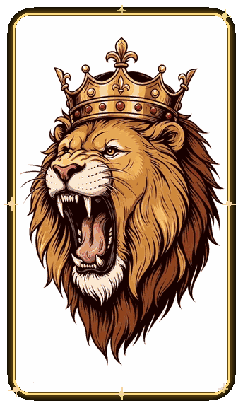

<!-- =========================================================
     GitHub Profile README — ธีมทองคำ
     ========================================================= -->

<!-- Header: แบนเนอร์คลื่นไล่สี ดำ -> ทอง -->

หากแบนเนอร์ไม่ขึ้น โปรดลองรีเฟรชอีกครั้งหรือตรวจสอบการเชื่อมต่ออินเทอร์เน็ต

<!-- รูปโปรไฟล์กลางหน้า — สลับตามธีม GitHub (มืด/สว่าง) อัตโนมัติ -->

  <picture>
    <source media="(prefers-color-scheme: dark)" srcset="./assets/profile-dark.gif" />
    
  </picture>

<!-- ข้อความพิมพ์อัตโนมัติ: แก้ใน lines= (คั่นบรรทัดด้วย ; และใช้ + แทนช่องว่าง) -->

  

  
  

<!-- 🔗 Nav: กระโดดไปแต่ละหมวด (แบบ resume) -->

  <a href="#-about-me">👋 About</a> •
  <a href="#-featured-projects">💼 Projects</a> •
  <a href="#tech-stack">🛠️ Stack</a> •
  <a href="#-github-stats">📊 Stats</a> •
  <a href="#-connect-with-me">📫 Connect</a>

<!-- คลื่นทองเรืองแสง — ใช้ GIF เพราะ GitHub ตัด SVG แอนิเมชันทิ้ง -->

  

---

<!-- รูปโปรไฟล์ย้ายขึ้นกลางหน้าแล้ว (ดูช่วงหัวไฟล์) ไม่ลอยขวาแล้ว -->

### 👑 About Me

- 👋 สวัสดีครับ ผม **saharatyokthuan** — Software Engineer & Designer จากประเทศไทย 🇹🇭
- 🔭 ตอนนี้กำลังทำ **[POS-MOBILE](https://github.com/saharatyokthuan/pos-mobile)** — ระบบขายหน้าร้าน PWA บนมือถือ (FastAPI + SQLite + Vanilla JS)
- 🌱 กำลังเรียนรู้ **System Design** และ **Cloud Architecture**
- 🎨 หลงใหลการออกแบบ **UI/UX** ที่ทั้งสวยและใช้งานง่าย
- 💬 คุยกับผมได้เรื่อง **Python, JavaScript, UI/UX**
- ⚡ เชื่อว่า UI ที่ดีคือผู้ขายที่เงียบที่สุด

### 🎯 What I Build

- **ระบบขายหน้าร้าน (POS)** — PWA ใช้บนมือถือได้จริง สแกนบาร์โค้ด, จัดการสต๊อก, ลูกหนี้, รายงาน, sync ข้อมูล, รองรับหลายร้าน
- **แอปการเงินส่วนตัว** — บันทึกรายรับรายจ่าย, งบประมาณ, เป้าหมายออม, จัดการหนี้สิน
- **คอร์ส/สื่อการสอน Python** — บทเรียน Python สู่การวิเคราะห์ข้อมูล พร้อมแบบฝึกหัดและเฉลย
- **เครื่องมืออำนวยความสะดวก** — สคริปต์ automate งานจุกจิกบน Termux/Linux ให้ทำงานเอง

### 💼 Featured Projects

| โปรเจกต์ | คืออะไร | เทคโนโลยี |
|---------|--------|----------|
| [**POS-MOBILE**](https://github.com/saharatyokthuan/pos-mobile) | ระบบขายหน้าร้าน PWA มือถือ — ขาย, สต๊อก, ลูกหนี้, รายงาน, multi-store, CI/CD | Python, FastAPI, SQLite, JS, PWA |
| [**budgetctrl**](https://github.com/saharatyokthuan/budgetctrl) | แอปบันทึกการเงิน — รายรับรายจ่าย, หนี้สิน, งบประมาณ, เป้าหมายออม | JavaScript |
| [**Cash-Flow**](https://github.com/saharatyokthuan/Cash-Flow) | จัดการการเงินส่วนตัว (โปรเจกต์แรก ๆ ของผม) | JavaScript |
| [**python-lessons**](https://github.com/saharatyokthuan/python-lessons) | คอร์ส Python สู่การวิเคราะห์ข้อมูล — 5 บทเรียน พร้อมแบบฝึกหัด+เฉลย | Python |

> 📦 ดูทั้งหมด: [github.com/saharatyokthuan?tab=repositories](https://github.com/saharatyokthuan?tab=repositories)

### Tech Stack

  

- **Backend:** Python, FastAPI, SQLite, REST API, Alembic
- **Frontend:** JavaScript, HTML5, CSS3, PWA, Vanilla SPA
- **Design:** Figma, UI/UX
- **Tools:** Git, Docker, Linux/Termux, GitHub Actions

### 📊 GitHub Stats

  
  

  

<!-- Top Repositories (แยก card แต่ละ repo — mobile-first: ซ้อนแนวตั้งบนมือถือ, วางข้างกันบนจอใหญ่) -->

  
  
  

<!-- 🐍 Snake กิน contribution (สร้างโดย GitHub Action ทุกวัน 01:30 UTC) -->

  <picture>
    <source media="(prefers-color-scheme: light)" srcset="https://raw.githubusercontent.com/saharatyokthuan/saharatyokthuan/snake-output/snake-light.svg" />
    
  </picture>

### 📫 Connect with me

<!-- QR Code ติดต่อ (LINE / GitHub) — mobile-first: ซ้อนแนวตั้งบนมือถือ, วางข้างกันบนจอใหญ่ -->

  <a href="https://line.me/ti/p/EXpe9RS-fJ" style="flex:1 1 200px;max-width:260px;text-decoration:none;display:flex;flex-direction:column;align-items:center;">
    
    Add LINE
  </a>
  <a href="https://github.com/saharatyokthuan" style="flex:1 1 200px;max-width:260px;text-decoration:none;display:flex;flex-direction:column;align-items:center;">
    
    Follow GitHub
  </a>

<!-- ⏸️ ยังไม่มีลิงก์จริง — เปิดลิงก์นี้เมื่อใส่ href ครบทุกบรรทัด

-->

<!-- Footer: คลื่นปิดท้าย -->

